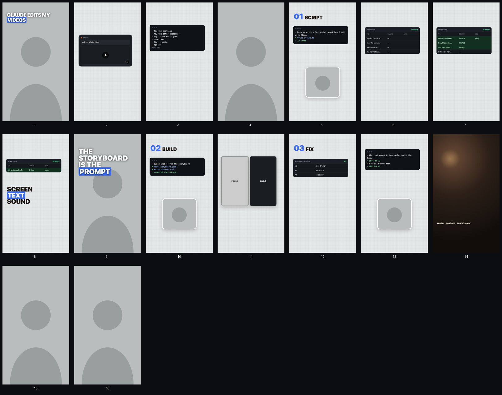

# Storyboard skill for Claude

Turn a short-form video script into a storyboard: every line gets its own shot with a 9:16
frame, the on-screen text, an edit note and the sound, and the filming is grouped into
sittings. Then the storyboard becomes the prompt: you have Claude build every graphic one
shot at a time, straight off it.



## Install

Paste this into Claude Code:

```
Install this Claude skill for me: https://github.com/chefy3x/storyboard-skill. Copy the storyboard folder into ~/.claude/skills/, then walk me through setting it up.
```

Or by hand:

```bash
git clone https://github.com/chefy3x/storyboard-skill
cp -r storyboard-skill/storyboard ~/.claude/skills/
```

In the Claude app (claude.ai or Desktop), zip the `storyboard` folder and upload it under
Settings → Capabilities → Skills.

Rendering the frames needs Python 3 and Google Chrome (or Chromium / Edge). `pip install
pillow` adds the contact sheet.

## Set up

The first time you use it, the skill walks you through a five-minute setup. It asks for 3 to
5 of your posted videos, studies them (shot lengths, framing, how you hook, your text style
and colors), grabs a clean still of your face, and saves a profile in
`~/.claude/storyboard-profile/`. Every storyboard after that matches your content. Say
"learn my style" any time to run it again.

## Use

Paste your script:

```
Storyboard this script. It's a 45 second Reel. [paste your script]
```

You get a `storyboard/<video>/` folder with `storyboard.json`, a frame per shot and
`board.html`, the whole board on one page.

Then build from it:

```
Build shot 4 from the storyboard as a 9:16 motion graphic: match the frame, the on-screen text and the edit note.
```

## What's in it

- `storyboard/SKILL.md`: the method (how to split a script, which shot types, the safe zones)
- `storyboard/kit/frame-kit.css`: the building blocks for frames (headline, terminal, chat, table, face box)
- `storyboard/kit/render.py`: renders the frames, the contact sheet and the board
- `example/`: the storyboard for the video this came from

By [@palalneish](https://www.instagram.com/palalneish). MIT license.
